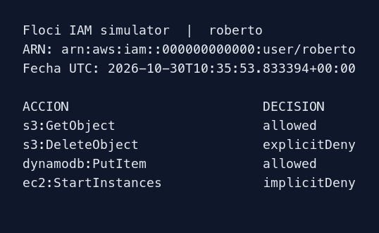
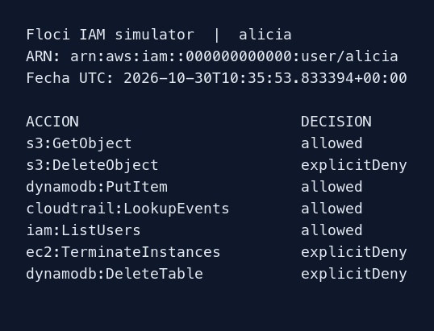
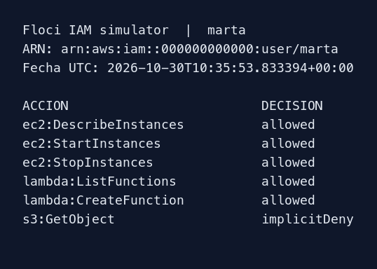
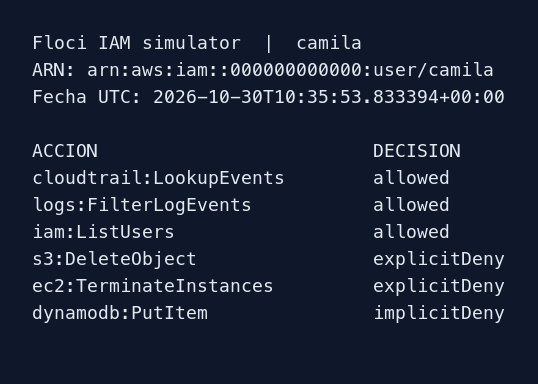

# Auditoría con el simulador IAM

Terraform creó los usuarios, grupos, pertenencias y políticas en Floci. El enunciado advierte que Floci no aplica por defecto las políticas al invocar los servicios. Por eso se usó `aws iam simulate-principal-policy` sobre el ARN de cada usuario. El simulador incluyó las políticas de todos sus grupos; no ejecutó las acciones sobre recursos reales.

## Resultados observados (selección)

| Usuario | Acción | Decisión |
| --- | --- | --- |
| roberto | `s3:GetObject` | `allowed` |
| roberto | `s3:DeleteObject` | `explicitDeny` |
| roberto | `dynamodb:PutItem` | `allowed` |
| alicia | `s3:GetObject` | `allowed` |
| alicia | `s3:DeleteObject` | `explicitDeny` |
| alicia | `cloudtrail:LookupEvents` | `allowed` |
| marta | `ec2:DescribeInstances` | `allowed` |
| marta | `ec2:StartInstances` | `allowed` |
| marta | `lambda:CreateFunction` | `allowed` |
| marta | `s3:GetObject` | `implicitDeny` |
| camila | `cloudtrail:LookupEvents` | `allowed` |
| camila | `logs:FilterLogEvents` | `allowed` |
| camila | `s3:DeleteObject` | `explicitDeny` |
| camila | `dynamodb:PutItem` | `implicitDeny` |

Estos resultados se obtuvieron el 30 de octubre de 2026. El archivo `evidence/verification.json` conserva la respuesta íntegra de Floci, incluidas las evaluaciones por acción; `evidence/verification.md` presenta la comparación entre valor esperado y obtenido. La comprobación automatizada también verificó las siete pertenencias, la coincidencia de las tres políticas aplicadas con los JSON del repositorio y la ausencia de políticas directas en usuarios.

`allowed` significa que existe un `Allow` aplicable; `implicitDeny`, que ninguna política concede la acción; `explicitDeny`, que una regla `Deny` aplicable prevalece sobre cualquier permiso concedido.

