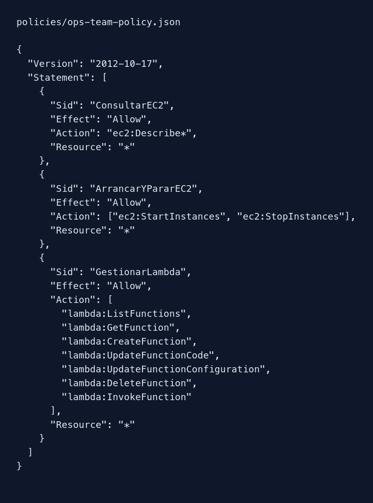

# Política de Ops-Team

Terraform lee `policies/ops-team-policy.json` y el módulo `iam-group` la asocia a Ops-Team como `OpsTeamPolicy`.

| Bloque | Efecto |
| --- | --- |
| `ConsultarEC2` | `ec2:Describe*` permite consultar instancias y otros datos EC2. |
| `ArrancarYPararEC2` | Permite `StartInstances` y `StopInstances`, sin conceder terminación. |
| `GestionarLambda` | Permite listar, consultar, crear, actualizar, borrar e invocar funciones Lambda mediante acciones enumeradas. |

En la simulación de `marta`, `ec2:DescribeInstances`, `ec2:StartInstances`, `ec2:StopInstances`, `lambda:ListFunctions` y `lambda:CreateFunction` resultaron `allowed`. `s3:GetObject` dio `implicitDeny`.

Se enumeran las acciones de Lambda en vez de usar `lambda:*`, para evitar permisos adicionales no exigidos. El emulador usa `Resource: "*"` porque el enunciado no define ARNs concretos; en una cuenta real se acotarían instancias y funciones por ARN y se revisarían dependencias como `iam:PassRole` para crear funciones con un rol de ejecución.
