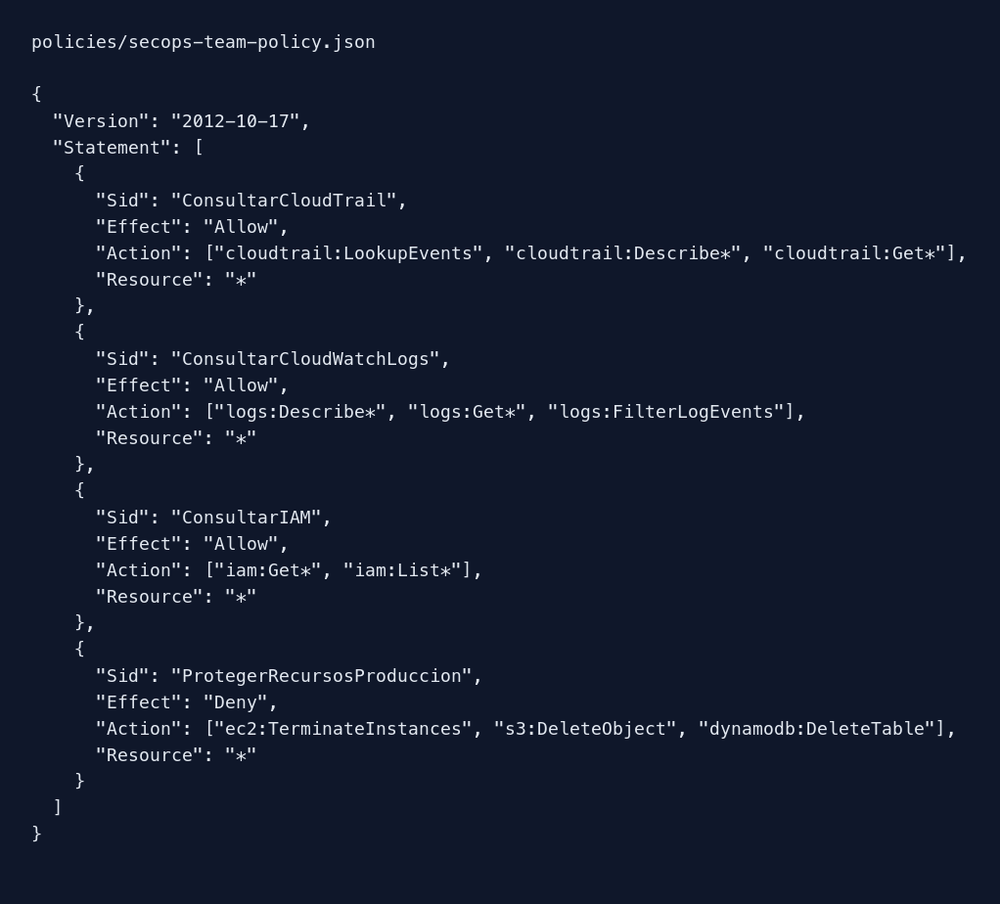

# Política de SecOps-Team

Terraform lee `policies/secops-team-policy.json` y el módulo `iam-group` la asocia a SecOps-Team como `SecOpsTeamPolicy`.

| Bloque | Efecto |
| --- | --- |
| `ConsultarCloudTrail` | Permite `LookupEvents`, `Describe*` y `Get*` de CloudTrail. |
| `ConsultarCloudWatchLogs` | Permite `Describe*`, `Get*` y `FilterLogEvents` de CloudWatch Logs. |
| `ConsultarIAM` | Permite `Get*` y `List*` de IAM para inspeccionar la configuración. |
| `ProtegerRecursosProduccion` | Deniega `ec2:TerminateInstances`, `s3:DeleteObject` y `dynamodb:DeleteTable`. |

El `Deny` se aplica a `Resource: "*"`: protege también los recursos de producción y, de forma deliberadamente más estricta, impide esas tres operaciones sobre cualquier recurso. Así seguirá prevaleciendo si en el futuro otro grupo concede permisos amplios. Para limitarlo solo a producción en AWS real harían falta nombres o etiquetas de recursos definidos y condiciones adecuadas a cada servicio.
